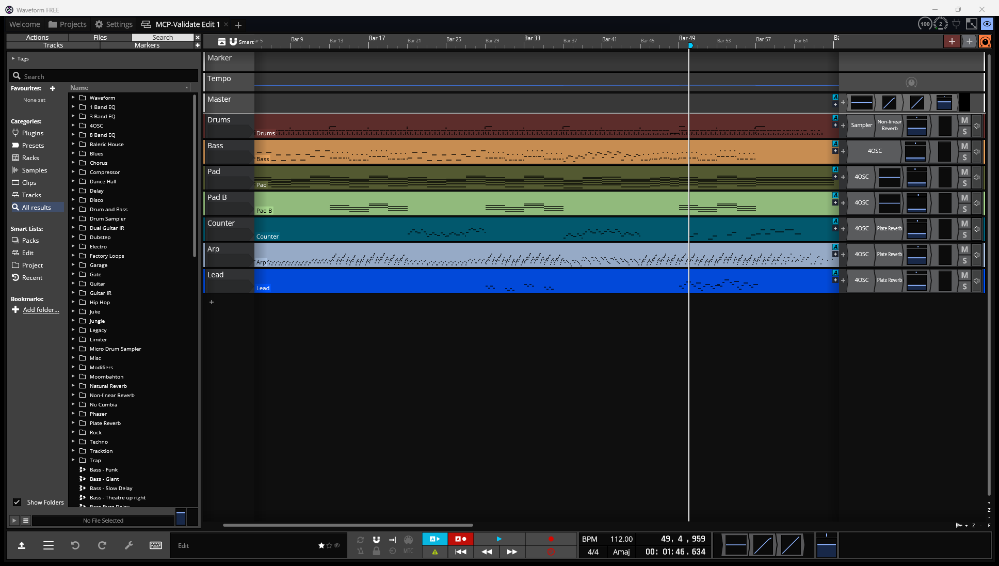

# Waveform MCP

[](LICENSE)
[](https://www.python.org/)

An [MCP](https://modelcontextprotocol.io/) server that gives an LLM agent control over [Tracktion Waveform](https://www.tracktion.com/products/waveform-pro). Ask Claude to write a song, balance a mix, or render to MP3 — and watch Waveform do it.


*A 64-bar synthwave instrumental composed via MCP tool calls — drums, bass, two pads, counter, arp, lead. Section markers, tempo automation, sidechain pump, plate reverb, clip-level fades, full master chain.*

---

## TL;DR

- **150+ MCP tools** spanning composition, MIDI, audio clips, plugins, automation, mixing, mastering, render, and Waveform UI control
- **Six composers** (synthwave, lofi, lofi-generative, djent, djent-real with VST amp sims, rainstorm) plus `compose_from_reference` and `compose_variations`
- **Music theory + mix balance knowledge** baked in — scales, progressions, voice leading, per-genre reference levels, plugin-aware fader calibration
- **Verified XML round-trip** between the in-memory model and Waveform's `.tracktionedit` format, with 250 regression tests guarding every fix

---

## What this gives you

- **150+ MCP tools** across edit lifecycle, tracks/buses, MIDI, audio clips, plugins, automation, music theory, mix balance, **composition primitives**, **drum pattern library**, **progression generator**, **voice leading**, **arrangement planner**, **audio analysis (LUFS / tempo / key detection)**, **reference song database**, **mastering chain templates**, **MIDI export**, **chord chart export**, **A/B snapshots**, **tool-call history**, render, loop library, VST discovery, schema capture, and Waveform UI control
- **Six composers** — `compose_lofi_track`, `compose_synthwave_track`, `compose_djent_track`, `compose_djent_real` (with VST amp sims), `compose_lofi_generative` (every seed = a different song), `compose_rainstorm`
- **Reference-driven composition pipeline** — point at any audio file (`compose_from_reference`) and the MCP analyzes it, builds a `CompositionSpec` of its tempo / key / sections / chord progression / instrumentation, optionally transcribes the polyphonic content (BasicPitch), detects reverb tail and sidechain pumping, then writes a Waveform edit modeled on it
- **Plugin-aware fader calibration** — `mix_apply_reference` knows that a sforzando-fed SFZ is ~16 dB quieter than a sample-based drum kit at the same fader, so role-target dB lookups land at the *audible* level you asked for instead of the literal fader value
- **`compose_variations`** to spin off N seeded variations of any composer
- **A music-theory knowledge layer** — scales, chord progressions, cadences, song forms, voice-leading rules, mix-balance reference levels per genre, reference song database
- **State-aware Waveform launch** — `waveform_launch` detects whether the file is already loaded, what view Waveform is on, whether a modal dialog is blocking, then chooses the right path (cold-start spawn, focus + revert from disk, or real OLE drag-drop from Explorer)
- **Verified round-trip** between the in-memory model and Waveform's `.tracktionedit` XML
- **Clip-level fades, gain, offset, automation curves** — proven primitives the LLM can use to iterate musically
- **Reliable workflow loop** — `compose → write → reload via File → Revert to saved → listen → tweak`
- **250 tests passing** — every fix has a regression test guarding it

---

## Status

Working end-to-end on **Windows + Waveform 13**. macOS / Linux paths exist for content discovery (presets, loop library, VST list) but Windows-only UI control via UIA / pywinauto for now.

Built and tested through ~30 hours of human-in-the-loop iteration with Claude. Both composers have been rendered to MP3 multiple times and the user has signed off on the resulting tracks.

---

## Quick start

### Install

```powershell
cd "C:\path\to\waveform MCP"
python -m venv .venv
.venv\Scripts\Activate.ps1
pip install -e .
```

### Wire to Claude (Code, Desktop, or any MCP client)

`~/.claude.json` or your client's MCP config:

```json
{
  "mcpServers": {
    "waveform": {
      "command": "waveform-mcp"
    }
  }
}
```

### Try it

```
Open Waveform, then ask Claude:

  "Use compose_synthwave_track to make a synthwave song,
   save it to my Documents/Waveform folder, and reload it
   in Waveform so I can hear it."
```

The LLM calls `compose_synthwave_track` → `waveform_revert_to_saved` and you press play. Then iterate: *"turn down the bass"* → the LLM updates `MIX_BALANCE["synthwave"]["bass"]` and reloads.

---

## Architecture

Four layers, each with a clear contract:

```
┌──────────────────────────────────────────────────────────────────┐
│  LLM (Claude / any MCP client)                                   │
└────────────────────────────┬─────────────────────────────────────┘
                             │ MCP stdio
┌────────────────────────────▼─────────────────────────────────────┐
│  MCP server (server.py) — 150+ tools                             │
└────────────────────────────┬─────────────────────────────────────┘
                             │
              ┌──────────────┼─────────────────────┬──────────────┐
              ▼              ▼                     ▼              ▼
      ┌──────────────┐ ┌──────────┐ ┌─────────────────────┐ ┌──────────────┐
      │ Edit model   │ │ Knowledge│ │ Reference pipeline  │ │  Waveform    │
      │ (in-memory)  │ │  (data)  │ │ (audio file → song) │ │  UI control  │
      ├──────────────┤ ├──────────┤ ├─────────────────────┤ ├──────────────┤
      │ Tracks       │ │ Scales   │ │ music-analyzer       │ │ pywinauto +  │
      │ Clips        │ │ Chords   │ │ reference_adapter    │ │ UIA + ffmpeg │
      │ Notes        │ │ Forms    │ │ poly_transcribe (BP) │ │ Drag-drop    │
      │ Plugins      │ │ Mix      │ │ production_analysis  │ │ Menu invoke  │
      │ Automation   │ │ Velocity │ │ automation_features  │ │ Revert       │
      │ Markers      │ │ Rhythm   │ │ → CompositionSpec    │ │ Render→MP3   │
      └──────┬───────┘ └──────────┘ └──────┬──────────────┘ └──────┬───────┘
             │                             │                       │
             │           ┌─────────────────┘                       │
             ▼           ▼                                         ▼
   ┌────────────────────────┐                          ┌────────────────────┐
   │ compose_from_spec      │                          │ Waveform 13        │
   │ + mix_calibration      │                          │ (the running app)  │
   │ ↓ xml_writer.py        │                          └────────────────────┘
   │ ↓ .tracktionedit       │ ◀──────────── State-aware launch ──────────┘
   └────────────────────────┘
```

**Key design choice:** The model is *not* a 1:1 of the Tracktion ValueTree — it's the shape the LLM wants to work with, projected onto the XML on save and projected back on load. This makes tools simple (`audio_clip_import(track_id, file_path, start_beats, length_beats, fade_in_beats, ...)`) instead of forcing the LLM to think in JUCE-internals.

---

## Tool catalog

### Edit lifecycle (`edit.py`)
`edit_create` · `edit_open` · `edit_save` · `flush` · `edit_summary` · `edit_inspect` · `undo` · `narrate`

### Tracks + mix + bus routing (`tracks.py`)
`track_add` · `track_remove` · `mix_set` · `mix_apply_reference` · `send_add` · `marker_add` · `tempo_set` · `key_set` · `bus_create` · `bus_route`

`mix_apply_reference(track_id, genre, role)` looks up the dB target from a curated mix-balance table (`MIX_BALANCE[genre][role]`) — the "kick is the anchor, bass 5-6 dB under" reference distilled into a callable.

`bus_create("Drum Bus")` + `bus_route(kick_track, drum_bus)` lets you stack tracks onto a submix for shared compression / EQ.

### MIDI (`midi.py`)
`midi_clip_add` · `midi_notes_add` · `midi_notes_clear` · `midi_clip_quantize`

### Audio clips (`audio.py`, `clips.py`)
`audio_clip_import` (with `gain_db`, `fade_in_beats`, `fade_out_beats`, `offset_in_source_beats`)
`clip_list` · `clip_set` · `clip_move` · `clip_resize` · `clip_duplicate` · `clip_remove`

### Plugins (`plugins.py`, `preset_library.py`)
`plugin_list` · `plugin_add` · `plugin_set_param` · `plugin_remove`
`plugin_add_reverb` (plate / natural / non-linear with sensible defaults)
`plugin_add_drum_kit` (Sampler-backed, one SOUND per pad)
`plugin_add_modifier` (LFO / envelope / sidechain — schema TBD on full Waveform support)
`plugin_discover` (parses `knownPluginList64.settings` to list installed VSTs)
**EQ + compressor helpers:** `eq_high_pass` · `eq_low_pass` · `eq_tilt` · `compress_glue` · `compress_smash`
`waveform_preset_list` · `waveform_preset_read` · `waveform_plugin_types`

### Composition primitives (`melody.py`, `drum_patterns.py`, `composition.py`)
`melody_generate(scale, contour, density)` — rule-based melody from contour shape (arch / descending / wave / question_answer / static)
`arp_pattern(chord, rate, direction, octaves)` — arpeggio over a chord (up / down / up_down / random / octave_alternate)
`bassline_generate(roots, feel)` — bass under a progression (pump / walking / half_time / sub / octave_jumps / dub)
`motif_develop(notes, transformation)` — variations: transpose / invert / retrograde / augment / diminish / sequence_up / sequence_down
`drum_pattern(genre, role, density, length_bars)` — 50+ named grooves indexed by (genre, role); synthwave, lofi, hip_hop, edm, house, techno, trap, dnb, rock, pop, ambient
`drum_pattern_list` — show the catalog
`progression_generate(root, mode, length, end_cadence, style)` — invent chord progressions; styles: pop / jazz / modal / synthwave / sad / uplifting
`voice_lead(prev_voicing, next_chord)` — minimal-motion voice leading
`arrangement_plan(genre, target_seconds, energy_curve)` — produce a section list with bars + role + energy 0..1; curves: slow_burn / immediate_hook / build_drop_build / call_response

### Audio analysis (`audio_analysis.py`, `audio_detect.py`)
`audio_loudness_lufs(file)` — integrated LUFS, true peak, LRA via ffmpeg ebur128
`audio_spectrum(file, bands=10)` — log-spaced RMS-per-band frequency balance
`audio_compare(a, b)` — diff LUFS / peak / per-band spectrum between two files
`audio_detect_tempo(file)` — BPM via onset autocorrelation (~1% accuracy on clear loops)
`audio_detect_key(file)` — root + mode via Krumhansl-Schmuckler chromagram

### Reference songs (`reference_songs.py`)
`reference_song_lookup(name)` / `reference_song_list` — curated DB of 11 references across synthwave / pop / house / ambient / lofi (Drive (Kavinsky), Midnight City (M83), Sweet Dreams, Africa, In the Air Tonight, Strobe, Miami, Hide and Seek, Still Alive, generic chillhop, generic outrun) with BPM, key, form hint, energy curve, signature elements.

### Mastering / mix workflow (`workflow.py`)
`master_chain_apply(template)` — drop-in chains: clean_pop / loud_edm / lofi_warm / cinematic_dynamic / podcast_voice / no_processing
`snapshot_save(name)` / `snapshot_recall(name)` / `snapshot_list` — A/B compare versions of an Edit
`edit_transpose(semitones)` — shift all MIDI notes
`edit_set_tempo(bpm)` — change project tempo
`compose_variations(composer_name, prefix, count)` — generate N seeded variations of any composer
`tool_history(last_n)` — list recently-called tools (auto-recorded by the @op decorator)
`edit_save_stem(track_names, out_path)` — save a stem-mix copy with named tracks soloed
`edit_export_chord_chart(out_path, format)` — text chord chart from markers + key
**`render_and_audit(mp3_path, revert_first?)`** — render → mp3 → analyze → return paths + balance/rhythm summary in ONE call. Replaces the manual revert→render→analyze chain that was the most-repeated incantation during iteration.
**`compose_and_reload(composer, out_path, ...)`** — dispatch jazz/synthwave/lofi composer AND `waveform_revert_to_saved` in one call. Avoids the compose-then-manually-revert dance.

### MIDI export (`midi_export.py`)
`edit_export_midi(out_path)` — Standard MIDI File (format 1) with one track per Edit MIDI track, plus tempo + time-sig in track 0.

### Automation (`automation.py`)
`automation_add` · `automation_envelope` · `automation_clear` · `automation_list`

Targets: `pan` and `plugin/<plugin_id>/<param>`. Volume target is **disabled** at the API level — Waveform's volume plugin doesn't honor our `<AUTOMATIONCURVE>` schema and silences the track. Use `mix_set`/`mix_apply_reference` for static levels and `clip_set(fade_in_beats|fade_out_beats)` for fades. (The MCP refuses `target="volume"` with a clear error pointing to alternatives.)

### Music theory knowledge (`music_theory.py`, `music_theory_data.py`)
17 query tools: `theory_scale` · `theory_modes` · `theory_diatonic_chords` · `theory_chord_progression` · `theory_cadences` · `theory_song_form` · `theory_section` · `theory_genre` · `theory_arrangement_layers` · `theory_velocity` · `theory_rhythm` · `theory_voice_leading_rules` · `theory_heuristics` · `theory_surprise_devices` · `theory_borrowed_chords` · `theory_mix_balance` · `theory_search`

The data behind these:
- 13 scales (major modes, harmonic minor, pentatonic, blues, etc.)
- 25+ chord progressions (axis_pop, ii_V_I, andalusian, lament_bass, …)
- Cadences, song forms, sections with role/density/dynamic profiles
- 14 genres with typical BPM, key tendencies, instruments, hallmark progressions
- Velocity / rhythm maps (swing ratios, accent bumps, ghost-note ranges)
- 13 songwriting heuristics (rule-of-3, contrast-required, surprise quota, …)
- 7 surprise devices (truck-driver modulation, deceptive cadence, …)
- **Mix balance reference table** — 14 genres × ~14 roles, fully annotated. Genres: pop / rock / metal / synthwave / lofi / hip_hop / edm / cinematic / ambient / **jazz / jazz_standard / rnb / country / folk / orchestral**.

`progression_generate(style="jazz")` now correctly tags V chords as `quality="dom7"` so downstream voicing produces dominant 7 (b7) instead of major 7 — the V-as-maj7 voicing was a recurring out-of-tune source.

### Composers (`composer.py`, `lofi_generative.py`, `synthwave_generative.py`, `jazz_generative.py`)
- `compose_lofi_track` — 32-bar lofi with drums, bass, keys, pad, melody, counter; section-aware velocity envelopes; tempo automation; lofi master chain. Accepts an optional `chord_progression` arg to override the default Fmaj7-Am7-Dm7-Cmaj7 vocabulary.
- `compose_lofi_generative` — *generative* lofi composer that drives `progression_generate`, `arrangement_plan`, `drum_pattern`, `melody_generate`, and `bassline_generate`. Every seed produces a meaningfully different song. **Bass locked to kick onsets** for rhythm-section meshing; **melody quantized to 8th-note grid**; **melody pinned to Salamander Grand Piano** instead of bare 4OSC default-saw; real multi-sample bass guitar when factory samples available.
- `compose_synthwave_generative` — generative synthwave composer with 4 always-on layers (drums, bass, pad, lead) + 7 optional layers per seed roll (sub-bass, pluck, counter, pad B, harmony, chimes, riser); section-aware harmonic variation (chorus V7 sub, bridge modulation); layer-by-layer build through intro/outro; lead/counter call-and-response; tom fills before chorus entries; 6 distinct arp profiles (classic 8th, broken 16th, off-beat, two-note pulse, triplet swirl, chord-tone sparse) so back-to-back songs sound different.
- **`compose_jazz_generative`** — jazz/jaunty composer with 5 tracks (drums, upright bass, Rhodes comp, piano lead, sax counter). Authentic walking bass library (7 patterns from Paul Chambers / Ron Carter vocabulary: 1-3-5-approach, 1-3-6-5, 1-3-6-b6, triplet on beat 4, octave drop, ghost 8th, 1-5-3 inversion). Salamander Grand piano lead with **call-and-response motif structure** (anchored downbeats, syncopated steps, octave-lifted climax phrases, contour-inverted variations). Drums **comp for the soloist** — ghost rim shots on piano off-beats during solo phrases, kick drops on beat 3, ride thinned, crash on entry. Per-section bass feels (two-feel for heads, walking for blowing, anticipations for transitions, chromatic at section boundaries). Pizzicato VSCO Contrabass with sample-range normalization. AABA form (intro/A1/A2/B/A3/[A4/B2/A5]/outro depending on length).
- `compose_synthwave_track` — older 64-bar synthwave with 7 tracks; 9-section form; per-section bass feels; section-keyed arp themes; sidechain-style filter pump
- `compose_djent_track` / `compose_djent_real` — progressive-metal composers (synthetic 4OSC vs full VST amp-sim chain)
- `compose_rainstorm` — ambient soundscape with rain + wind + lowpassed-distant thunder

### Ensemble cohesion (`ensemble.py`)
Shared cross-genre primitives that prevent the "puzzle glued together" feeling where tracks sound great alone but don't mesh:
- `section_at_bar(plan, bar)` / `section_start_bar(plan, role)` / `bar_in_phrase(plan, bar)` — shared section/phrase position math
- `is_solo_phrase(plan, bar)` — every 3rd & 4th of each 4-phrase cycle is a "solo phrase" where the lead peaks (octave-lifted/ornamented). Drums comp louder, bass walks chromatic, rhodes lays sparser.
- `section_dynamic_scale(plan, bar)` — velocity multiplier per section role for ensemble breathing (intro 0.55 → A1 0.85 → B 1.05 → outro 0.55). Apply uniformly to drums/bass/keys/lead.
- `scale_velocities(notes, plan)` — bulk-apply the dynamic curve to a note list.
- `comp_for_lead_drums(lead_notes, plan, total_bars)` — generate a drum part that responds to the soloist: ghost rim shots on lead off-beats during solo phrases, phrase-end tom fills, crash on solo entry, sparse ride during peaks.
- `ensemble_dynamics` (MCP tool) — return per-section velocity multipliers as data.

### Reference-driven composition (`composition_spec.py`, `reference_adapter.py`, `tools/compose_from_spec.py`, `tools/import_song.py`)
- `analyze_to_spec(audio_path)` — runs music-analyzer on any audio file, returns a `CompositionSpec` dict (tempo, key, sections, chord progression, instrumentation) without writing any edit. Use to inspect / hand-edit the spec before composing.
- `compose_from_reference(audio_path, out_path)` — full pipeline: analyze → adapt → optionally transcribe with BasicPitch → optionally detect reverb / sidechain via `production_analysis` → build `.tracktionedit`. Returns fidelity caveats listing what's reproduced exactly versus approximated.
- `compose_from_spec_json(spec | spec_path, out_path)` — build an edit from an inline or hand-edited `CompositionSpec` JSON. Useful when you've inspected an analyzed spec and want to tweak it before building.
- `compose_from_spec(spec, out_path)` — internal builder used by all of the above; drives the existing primitives (`track_add`, `plugin_add`, `midi_clip_add`, `mix_apply_reference`) so output is calibration-aware.

### Render (`render.py`, `waveform_workflows.py`)
`waveform_render_export` · `waveform_render_to_mp3` (uses bundled ffmpeg + libmp3lame)

### Waveform UI control (`waveform_workflows.py`)
`waveform_new_project` · `waveform_save` · `waveform_revert_to_saved` *(the iteration loop unlocker)* · `waveform_close_active_tab` · `waveform_active_tab` · `waveform_project_loaded` · `waveform_menu_invoke` · `waveform_add_track` · `waveform_select_track` · `waveform_insert_clip_on_track` · `waveform_build_skeleton`

### App lifecycle + state-aware launch (`waveform_app.py`)
`waveform_locate` · `waveform_status` · `waveform_focus` · `waveform_quit` · `waveform_settings_dir`

`waveform_launch(file_path)` is **state-aware** — it inspects Waveform's UI before deciding what to do:

| Detected state | Action |
|---|---|
| App not running | Cold-start spawn with file as CLI arg |
| File already loaded as a tab | Focus tab + revert from disk |
| Modal dialog blocking input | Bail with a clear `stage: modal_dialog_blocking` error |
| App on Welcome / Projects / Settings (no edit view) | Auto-switch to an existing edit tab so drop has a target |
| App on edit timeline, file not loaded | **Real OLE drag-drop from Explorer** (the only mechanism Waveform's JUCE `IDropTarget` actually honors for `.tracktionedit` files in a running instance) |

Drag-drop is implemented via `explorer.exe /select,<file>` to pre-select the file in Explorer, UIA-find its on-screen rect, then SendInput-level mouse drag to Waveform's window — same code path JUCE sees from a real user drag.

### Loop library (`loops.py`)
`loop_search` (by tempo / bars / name) · `loop_drop` (auto-length, fit-to-tempo)

### Schema capture (`schema_capture.py`)
`schema_snapshot_current_edit` · `schema_diff_snapshots` · `schema_list_snapshots`

### Low-level UI / desktop (`win_input.py`, `desktop.py`)
18 primitives for window management, UIA inspection, key/click sending, screenshots.

---

## Layout

```
waveform-mcp/
├── src/waveform_mcp/
│   ├── server.py                       MCP server entry (stdio)
│   ├── model.py                        Edit / Track / Clip / Note / AutomationLane dataclasses
│   ├── xml_writer.py                   Edit → .tracktionedit
│   ├── xml_reader.py                   .tracktionedit → Edit
│   ├── audio_convert.py                ffmpeg-backed MP3→WAV cache for Sampler sources
│   ├── music_theory_data.py            SCALES, PROGRESSIONS, GENRES, MIX_BALANCE, ...
│   ├── events.py                       event bus + JSONL log
│   ├── diff.py                         Edit-diff for change events
│   ├── mix_calibration.py              Plugin-aware fader calibration (offset table + lookup)
│   ├── composition_spec.py             Pure dataclass schema for analysis-driven composition
│   ├── reference_adapter.py            Analyzer JSON → CompositionSpec (chord / section / timing helpers)
│   ├── poly_transcribe.py              Spotify BasicPitch wrapper — polyphonic audio → MIDI
│   ├── production_analysis.py          RT60 / sidechain detection from rendered audio
│   ├── automation_from_features.py     Audio features → automation breakpoints (pan / cutoff / volume rides)
│   ├── tools/
│   │   ├── edit.py                     Edit lifecycle
│   │   ├── tracks.py                   Tracks + mix balance (calibration-aware)
│   │   ├── midi.py                     MIDI clips/notes
│   │   ├── audio.py                    Audio clip import
│   │   ├── clips.py                    Clip mutators (move, resize, duplicate, set)
│   │   ├── plugins.py                  Plugin add + auto-drum-kit-load + reverb / EQ / comp helpers
│   │   ├── automation.py               Automation lanes (pan + plugin params)
│   │   ├── preset_library.py           Factory preset browser
│   │   ├── loops.py                    Loop library search + drop
│   │   ├── render.py                   Render stubs
│   │   ├── waveform_app.py             App lifecycle + state-aware launch (cold-start / revert / drag-drop)
│   │   ├── waveform_workflows.py       UI workflows (revert, render-to-mp3, etc.)
│   │   ├── desktop.py                  Generic desktop primitives
│   │   ├── win_input.py                Windows UIA + keystroke primitives
│   │   ├── schema_capture.py           Hand-fixture capture for schema reverse-engineering
│   │   ├── music_theory.py             Theory query tools
│   │   ├── composition.py              progression_generate / voice_lead / arrangement_plan
│   │   ├── melody.py                   melody_generate / arp_pattern / bassline_generate / motif_develop
│   │   ├── drum_patterns.py            50+ named drum grooves indexed by (genre, role)
│   │   ├── audio_analysis.py           LUFS / spectrum / compare via ffmpeg
│   │   ├── audio_detect.py             BPM + key detection from audio
│   │   ├── reference_songs.py          Curated reference song database
│   │   ├── workflow.py                 Master chain templates / snapshots / variations / chord chart export
│   │   ├── midi_export.py              .mid export
│   │   ├── composer.py                 compose_lofi_track, compose_synthwave_track, compose_djent_*, compose_rainstorm
│   │   ├── lofi_generative.py          compose_lofi_generative (every seed = different song)
│   │   ├── compose_from_spec.py        Generic spec → .tracktionedit builder
│   │   ├── import_song.py              analyze_to_spec / compose_from_reference / compose_from_spec_json
│   │   └── common.py                   @op decorator (apply + diff + event)
│   └── preview/
│       ├── app.py                      FastAPI + websocket
│       └── static/                     HTML / JS piano-roll
├── tests/                              250 tests covering primitives, composers, calibration, adapter, builder, audit regressions
├── scripts/
│   ├── lofi_from_ecstasy.py            Demo: build a lofi track inspired by another song's chord palette
│   └── run_analyzer.py                 Run music-analyzer on a rendered file + measure stems
├── docs/
│   ├── img/synthwave_arrangement.png
│   ├── ARCHITECTURE.md
│   ├── EVENT_SCHEMA.md
│   └── EDIT_MODEL.md
├── pyproject.toml
└── README.md
```

---

## The iteration loop that actually works

After many false starts, here's the loop that lets the LLM and the user collaborate on a track without restarting Waveform every cycle:

```
1. Compose / mutate            → composer.compose_*  or clip_set / mix_apply_reference
2. Save to disk                → edit_save / flush  (writes .tracktionedit)
3. Reload in Waveform          → waveform_revert_to_saved
                                  (File → Revert to saved state, auto-confirms popup)
4. User listens                → "turn the arp up"
5. Update MIX_BALANCE or run a clip mutator
6. → goto 2
```

The killer move was discovering Waveform's **File → Revert to saved state** menu item: it forces the open Edit to reload from disk, which is what makes external mutation visible without closing/reopening the project. `waveform_revert_to_saved` automates that path with retry.

---

## Mix balance reference

`mix_apply_reference` reads from a curated table of "kick is the anchor; bass 5-6 dB under; lead similar to bass; pad/arp 6-9 dB under lead; ambience deepest" — distilled across genre tutorials, mastering blogs, and tuned-by-ear iterations:

```python
MIX_BALANCE["synthwave"] = {
    "drums": -7, "kick": -6, "snare": -10, "hat": -16,
    "bass": -25, "sub_bass": -28,           # background-level texture
    "lead": -15, "pad": -19, "arp": -8,     # arp-driven mix
    "counter": -14, ...
}
```

Composers call `tracks.mix_apply_reference({track_id, genre, role})` once per track. Tweak the table once, every composer rebalances.

Sources informing the table:
- [Mastering The Mix — How To Balance Kick And Bass](https://www.masteringthemix.com/blogs/learn/118131269-how-to-balance-kick-and-bass-in-a-mix)
- [Mastering The Mix — How To Mix Bass Synth](https://www.masteringthemix.com/blogs/learn/how-to-mix-bass-synth)
- [eMastered — Balance All The Elements](https://emastered.com/blog/balancing-levels)

---

## Plugin-aware fader calibration

`MIX_BALANCE[genre][role]` says "rhythm guitar at -8 dB" — but a sample-based drum kit at unity fader is roughly *16 dB louder* than a sforzando-driven SFZ at unity fader. So setting drums to -5 dB and rhythm guitar to -8 dB on the literal fader produces a mix where drums are about 13 dB too loud, not 3.

`mix_calibration.py` solves this. Every plugin chain has a known output-offset relative to a "sample-based drum sampler at unity = 0 dB" reference:

```python
PLUGIN_CHAIN_OFFSETS_DB = {
    ("sampler",):                     0.0,    # reference
    ("4osc",):                       -8.0,
    ("sforzando",):                 -16.0,    # bare sforzando + typical SFZ
    ("sforzando", "anvil", "mt-a", "tsc 1.1"):  0.0,    # full guitar chain ≈ unity
    ("808 kit",):                     0.0,    # named alias for sampler
    ("lofi bass",):                   0.0,    # multi-sample bass guitar
    ...
}
```

The table is **bulk-seeded at registry-build time** — every preset known to the instrument registry (94 entries: Salamander Grand variants, all VSCO instruments, all 4OSC presets) gets a sensible default chain offset so the calibrator stops emitting "no match → -10 dB default" warnings. Manual entries in the table take precedence; bulk-seeding only fills gaps. New presets equipped at runtime auto-register too.

`mix_apply_reference(track_id, genre, role)` now does:

```
fader_db = role_target_db − chain_offset_db(track.plugins) + extra_offset_db
```

So "rhythm guitar at -8 dB" lands at the correct *audible* -8 dB regardless of whether the chain is a single 4OSC patch or `sforzando→Anvil→MT-A→TSC` — the fader value gets compensated automatically.

**Robustness:** lookups never raise. Unknown chains fall back to a conservative -10 dB offset and surface a `chain_offset_db: ... → no match` warning in logs, so any composer that ships a new plugin chain immediately knows to register an offset. Final fader values are clamped to `[-32, +8]` dB. Identical inputs always produce identical outputs.

---

## Reference-driven composition

Point at any audio file and the MCP can produce a new `.tracktionedit` modeled on it — using its tempo, key, structure, chord progression, and (optionally) transcribed melodic content.

```
audio file → music-analyzer → analyzer JSON → reference_adapter
        → CompositionSpec → compose_from_spec → .tracktionedit
```

### Phase A — what's reproduced exactly

- **Tempo + key + time-sig** — pulled directly from the analyzer
- **Section timeline** — intro / verse / chorus / breakdown / etc. with per-section density and brightness, snapped to bar boundaries so drum loops align with section starts
- **Chord progression** — every detected chord placed beat-aligned on the chord track. Bass roots auto-follow.
- **Form fidelity** — overlapping or out-of-order sections from the analyzer get resolved to a clean monotonic timeline
- **Plugin-aware mix calibration** at the end so the cover comes out balanced

### Phase B — fidelity upgrades (opt-in, all gracefully degrade if deps absent)

- **`poly_transcribe.py` (Spotify BasicPitch)** — when installed, transcribes the audio into MIDI notes (any polyphony) and routes them to the right tracks by pitch range (bass / lead / keys). Notes are quantized to a 16th-note grid and same-pitch micro-collisions are merged.
- **`production_analysis.py`** — Schroeder-integration RT60 estimation per stem (auto-applies to plate reverb plugin params), sidechain-pump detection (envelope correlation against drum onsets, applies to a kick-triggered ducking compressor).
- **`automation_from_features.py`** — pan-from-stereo-balance time-series, volume rides from RMS envelope, filter cutoff curves from spectral centroid trajectory.

### What it doesn't reproduce

- **Vocals as vocals** — no synth-vocal layer. Vocal lines fall through to the Lead track as a synth, or are skipped.
- **Exact polyphonic notes** — BasicPitch is the SOTA open transcriber but still ~70-90% F1 on dense mixes; covers will be in the same key with similar shape, not bit-exact.
- **Production tone exactly** — first-order match via plugin chain selection + reverb / sidechain heuristics, not a tone clone.

### Public tools

```python
analyze_to_spec({"audio_path": "...wav"})
# → {"ok": True, "spec": {...}, "summary": {tempo, key, sections, ...},
#    "fidelity_caveats": [...], "transcription": {used, note_count, ...}}

compose_from_reference({"audio_path": "...wav", "out_path": "...tracktionedit"})
# Full pipeline: analyze + adapt + transcribe + build + save

compose_from_spec_json({"spec": {...}, "out_path": "...tracktionedit"})
# Build from a hand-edited or saved CompositionSpec
```

To get the Phase B upgrades:
```powershell
<music-analyzer-venv>\Scripts\pip install basic-pitch onnxruntime
```

The MCP detects installed deps and uses them when available; without them the pipeline still produces a structurally-faithful cover, just with chord-tone placeholders for the lead/melody instead of real transcribed notes.

---

## Known limitations

- **Track-volume `AUTOMATIONCURVE` is disabled.** Waveform's `volume` plugin doesn't honor our curve schema and silences the affected track. The MCP refuses the target with a clear error and points to working alternatives (clip fades, multiple clips with per-clip gain, static `mix_set`).
- **Plugin modifier matrix is exploratory.** `plugin_add_modifier` writes a generic modmatrix shape; needs a hand-edited fixture to confirm the per-plugin schema before LFO modulation works reliably for 4OSC and friends.
- **Headless render not built yet.** `waveform_render_to_mp3` drives Waveform's UI export — works, but requires Waveform to be running. A C++ helper linking `tracktion_engine` is the eventual fix.
- **Linux/macOS UI control absent.** Content discovery (presets, loop library, VST list) is OS-aware; UI automation is Windows-only.
- **Reference covers don't reproduce vocals as vocals.** No singing-synth integration. Vocal melody lines either fall through to a synth Lead or are skipped; lyrics module captures text but it's not played back.
- **Poly transcription is approximate.** BasicPitch sits at ~70-90% F1 on clean material, lower on dense metal mixes. Covers will be in the same key with similar shape, not the exact notes.

### Solved (kept here for context — these used to be limitations)

- **Drum sampler silent in spec-driven composers** — `plugin_add` now auto-populates a Sampler with the factory 808 kit when added to a track named `Drums` / `Kit` / `Percussion`. Single fix benefits every composer.
- **Drag-drop file open into running Waveform** — works via real OLE drag-drop from Explorer (`waveform_launch` triggers it automatically when the file isn't already loaded). Used to be impossible because Waveform's single-instance handler eats CLI-arg-based forwarding.
- **State-aware launch flow** — `waveform_launch` no longer drags files into the wrong view; it auto-detects modal dialogs, the active tab, and the active view, picks the right action.
- **Plugin-name-mismatch silently breaking calibration** — calibration table now covers all named-kit aliases (`808 Kit`, `Lofi Bass`, `Counter Synth`, etc.) so composer-named plugins resolve correctly.

---

## Building blocks for next iterations

- Capture a real Waveform fixture for `<AUTOMATIONCURVE paramID="volume">` so volume automation can be re-enabled
- C++ headless render helper on `tracktion_engine`
- Drum Sampler / Micro Drum Sampler real fixture (currently fall back to plain Sampler)
- Sidechain modifier capture
- Clip Launcher (v13) support
- Linux UI control via `xdotool`/`wmctrl` once UIA is no longer the only path
- Singing-synth integration (Sinsy / SynthV Lite) so `compose_from_reference` can reproduce vocal melodies
- Voice leading between Keys and Melody so they don't clash on shared scale degrees
- Drum-pattern variation per section (fills on section boundaries, ghost-note humanization)
- Real Jazz Kit sample pack (current `_jazz_kit_sounds()` remaps 808 Kit samples — fine but limited)
- Per-stem loudness analysis driven by htdemucs (currently only band-energy %; can't tell "is bass quiet, or just in the wrong frequencies")
- `audition_preset(preset_name, chord)` quick-listen tool — one-click preview before committing to a song
- `compose_with_iteration(genre, target_seconds, max_iter)` — auto-render, auto-analyze, auto-tune mix offsets toward genre targets in a loop

---

## License

GPL-3.0-or-later (matches `tracktion_engine` if/when the C++ render helper links to it).
